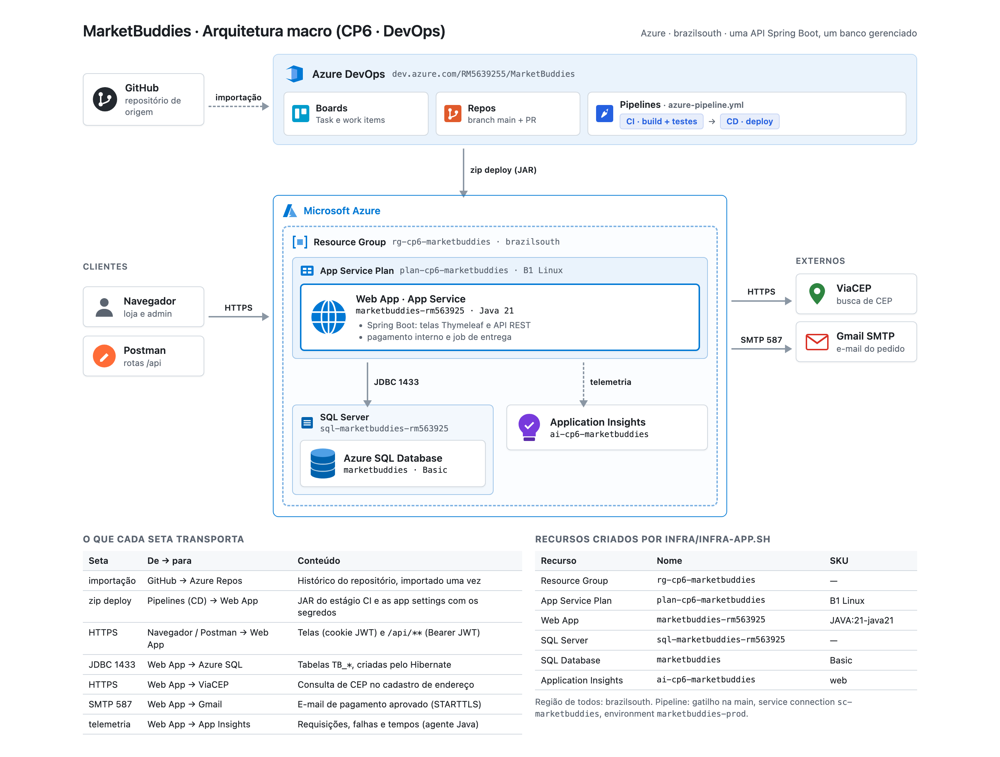

# MarketBuddies — CheckPoint 6 | DevOps Tools e Cloud Computing

Mercado express com loja web e API REST em Spring Boot, publicado na Azure por uma pipeline CI/CD do Azure DevOps.
A API roda num Azure Web App Linux (Java 21) e grava no Azure SQL Database. A infraestrutura é criada por um script
Azure CLI; o build, os testes e o deploy são feitos pelo `azure-pipeline.yml`.

---

## Links

| Recurso | URL |
|---------|-----|
| Azure DevOps (Boards, Repos, Pipelines) | https://dev.azure.com/RM5639255/MarketBuddies |
| Aplicação (Azure Web App) | https://marketbuddies-rm563925.azurewebsites.net |
| Vídeo | a preencher |

---

## Integrantes

| Nome | RM |
|------|----|
| Felipe Yuiti Ishii | 565339 |
| Gabriel Nogueira Peixoto | 563925 |
| Giovanna Neri dos Santos | 566154 |
| Mariana Inoue | 565834 |

**Turma:** 2TDSR

---

## Descrição da solução

O MarketBuddies é a loja de um mercado express. O visitante navega pela vitrine e monta o carrinho. O cliente
(perfil `CUSTOMER`) cadastra endereços de entrega, fecha o pedido e acompanha o pagamento e a entrega. A gerência
(perfil `ADMIN`) cuida dos produtos, das zonas de entrega, dos pedidos e do dashboard.

O fluxo de um pedido:

1. O cliente escolhe um endereço no checkout. O CEP do endereço cai numa zona de entrega, que define frete e prazo.
2. O pedido nasce `AWAITING_PAYMENT`, com o estoque reservado e o endereço copiado para o pedido.
3. O pagamento é autorizado dentro da própria API, de forma assíncrona (cerca de 3 s depois): aprovado ou recusado.
4. Aprovado, a API envia o e-mail de confirmação e a entrega começa: `EM_SEPARACAO` → `SAIU_PARA_ENTREGA` →
   `ENTREGUE`, uma etapa a cada 20 s.

Ao cadastrar um endereço, a API consulta o **ViaCEP** e preenche rua, bairro, cidade e UF.

A solução é um único deployable: telas Thymeleaf e rotas `/api/**` no mesmo Spring Boot.

<table>
  <tr>
    <td align="center" valign="top"><a href="assets/tela-vitrine.png"></a><br><sub>Vitrine</sub></td>
    <td align="center" valign="top"><a href="assets/tela-dashboard.png"></a><br><sub>Dashboard da gerência</sub></td>
  </tr>
</table>

---

## Benefícios para o negócio

- **Frete calculado na hora.** O cliente vê zona, frete, prazo e total antes de pagar. A gerência muda as faixas de
  CEP e as taxas pela tela, sem deploy.
- **Menos erro de endereço.** O ViaCEP preenche o endereço a partir do CEP. O pedido guarda uma cópia do endereço,
  então editar ou excluir o cadastro não muda o histórico.
- **Acompanhamento do pedido.** O cliente vê o pagamento e cada etapa da entrega na página do pedido, e recebe o
  e-mail de confirmação.
- **Entrega contínua.** Todo merge na `main` compila, roda os testes e publica a nova versão. Se um teste falha, o
  deploy não acontece.
- **Infraestrutura reprodutível.** Um script cria todos os recursos na Azure; outro apaga tudo.

---

## Arquitetura macro



O usuário acessa o Web App por HTTPS (navegador ou Postman). O Web App fala com o Azure SQL por JDBC (porta 1433),
com o ViaCEP por HTTPS e com o Gmail por SMTP (porta 587), e manda telemetria ao Application Insights. A pipeline do
Azure DevOps publica o JAR no Web App por zip deploy. O repositório foi importado do GitHub.

Fonte do desenho: [`docs/arquitetura/arquitetura-macro.html`](docs/arquitetura/arquitetura-macro.html).

---

## Recursos Azure criados pelo script

Script: [`infra/infra-app.sh`](infra/infra-app.sh). Para apagar tudo: [`infra/destroy.sh`](infra/destroy.sh).

| Recurso | Nome | SKU | Região |
|---------|------|-----|--------|
| Resource Group | `rg-cp6-marketbuddies` | — | brazilsouth |
| Application Insights | `ai-cp6-marketbuddies` | web | brazilsouth |
| SQL Server (lógico) | `sql-marketbuddies-rm563925` | — | brazilsouth |
| SQL Database | `marketbuddies` | Basic | brazilsouth |
| App Service Plan | `plan-cp6-marketbuddies` | B1 Linux | brazilsouth |
| Web App | `marketbuddies-rm563925` | `JAVA:21-java21` | brazilsouth |

O script também:

- registra os providers `Microsoft.Web`, `Microsoft.Insights`, `Microsoft.OperationalInsights` e `Microsoft.Sql`;
- cria as regras de firewall do SQL Server `AllowAzureServices` e `AllowMeuIP` (IP de quem roda o script);
- liga o Always On e os logs do Web App;
- grava as app settings que não são segredo (App Insights, `TZ`, `WEBSITES_CONTAINER_START_TIME_LIMIT`, `APP_BASE_URL`);
- conecta o Web App ao Application Insights;
- imprime no fim a `DB_URL` para cadastrar na pipeline.

A senha do admin do SQL Server (`mbadmin`) é digitada na hora e não fica no arquivo.

---

## Pipeline CI/CD

Arquivo: [`azure-pipeline.yml`](azure-pipeline.yml). Detalhes e ordem de execução: [`docs/pipeline.md`](docs/pipeline.md).

- **Gatilho:** push na `main` (inclui o merge de PR).
- **Agente:** `ubuntu-latest`.
- **Estágio CI — Build e Testes:** Java 21 (`JavaToolInstaller@0`) → `Maven@4` com `clean package` em
  `marketbuddies-api/pom.xml` → testes publicados (`**/surefire-reports/TEST-*.xml`, título "Testes de Código") →
  cópia do JAR → artefato `app`.
- **Estágio CD — Deploy no Azure Web App:** só roda se o CI passou. Job `deployment` no environment
  `marketbuddies-prod` → baixa o artefato → `AzureAppServiceSettings@1` grava as variáveis no Web App →
  `AzureWebApp@1` publica o JAR por zip deploy.
- **Service connection:** `sc-marketbuddies` (Azure Resource Manager, escopo na assinatura).

Os resultados dos testes aparecem na aba **Tests** da execução.

### Variáveis da pipeline

Cadastradas em Pipelines → Edit → Variables. Nenhum valor fica no repositório.

| Variável | Secreta | Conteúdo |
|----------|:-------:|----------|
| `DB_URL` | não | JDBC do Azure SQL, impressa no fim do `infra-app.sh` |
| `DB_USER` | não | usuário admin do SQL Server |
| `DB_PASSWORD` | sim | senha do admin do SQL Server |
| `JWT_SECRET` | sim | chave do token JWT (32 caracteres ou mais) |
| `ADMIN_PASSWORD` | sim | senha do usuário ADMIN da loja |
| `MAIL_USERNAME` | sim | conta Gmail que envia os e-mails |
| `MAIL_PASSWORD` | sim | senha de app do Gmail |

`DDL_AUTO=update` é fixo no YAML: o Hibernate cria e atualiza as tabelas na primeira subida.

---

## Modelo de dados

As tabelas são criadas pelo Hibernate a partir das entidades JPA. O DDL completo fica em [`script.sql`](script.sql), na
raiz: é o mesmo DDL que criou o banco no Azure SQL (profile `schema`, ver `application-schema.yaml`).

| Tabela | Conteúdo | Relacionamentos |
|--------|----------|-----------------|
| `TB_USERS` | clientes e admin: nome, e-mail único, senha (hash BCrypt), perfil | 1:N com `TB_ADDRESSES` e `TB_ORDERS` |
| `TB_PRODUCTS` | nome, categoria, descrição, custo, markup, preço, desconto, estoque | 1:N com `TB_ORDER_ITEMS` |
| `TB_ADDRESSES` | endereços do cliente: rótulo, CEP, rua, número, complemento, bairro, cidade, UF | N:1 `TB_USERS` (`user_id`) · 1:N `TB_ORDERS` (`address_id`) |
| `TB_DELIVERY_ZONES` | faixas de CEP: nome único, CEP inicial e final, taxa, prazo em dias | sem FK: o pedido acha a zona pelo CEP e copia taxa e prazo |
| `TB_ORDERS` | status do pagamento, total, código de autorização, cópia do endereço (`delivery_*`), frete, prazo, status da entrega | N:1 `TB_USERS` (`user_id`) · N:1 `TB_ADDRESSES` (`address_id`, pode ser nulo) · 1:N `TB_ORDER_ITEMS` e `TB_EMAILS` |
| `TB_ORDER_ITEMS` | produto, quantidade, preço e custo unitários no momento da compra | N:1 `TB_ORDERS` (`order_id`) · N:1 `TB_PRODUCTS` (`product_id`, pode ser nulo) |
| `TB_EMAILS` | e-mails de confirmação: remetente, destinatário, assunto, corpo, status (`SENT`/`ERROR`) | N:1 `TB_ORDERS` (`order_id`) |

- Excluir um endereço zera `address_id` nos pedidos; a cópia em `delivery_*` fica.
- Excluir um produto zera `product_id` nos itens; nome e preço do item ficam.

---

## Rotas dos CRUDs

Base URL: `https://marketbuddies-rm563925.azurewebsites.net` (local: `http://localhost:8080`).

Autenticação: `POST /api/auth/login` devolve `accessToken`; as demais rotas usam `Authorization: Bearer <token>`.
Erros voltam em JSON com `status`, `message`, `path` e `errors` por campo.

### Autenticação

| Método | Rota | Perfil | Descrição |
|--------|------|--------|-----------|
| `POST` | `/api/auth/signup` | público | Cadastra um cliente (201; 409 se o e-mail já existe) |
| `POST` | `/api/auth/login` | público | Devolve o token JWT (200; 401 se inválido) |
| `GET` | `/api/auth/me` | autenticado | Dados do usuário do token |

### Produtos — `TB_PRODUCTS`

| Método | Rota | Perfil | Descrição |
|--------|------|--------|-----------|
| `GET` | `/api/products?search=&category=` | público | Lista o catálogo, com filtros opcionais |
| `GET` | `/api/products/{id}` | público | Busca por id (404 se não existe) |
| `POST` | `/api/products` | ADMIN | Cria (201) |
| `PUT` | `/api/products/{id}` | ADMIN | Atualiza (200) |
| `DELETE` | `/api/products/{id}` | ADMIN | Exclui (204); os itens de pedido perdem a referência |

| Campo | Obrigatório | Regra |
|-------|:-----------:|-------|
| `name` | sim | até 80 caracteres |
| `category` | sim | valor do enum `Category` |
| `description` | não | até 500 caracteres |
| `cost` | sim | maior que 0, 2 casas |
| `markupPercentage` | sim | 0 a 500 |
| `discountPercentage` | sim | 0 a 90 (0 = sem oferta) |
| `stock` | sim | 0 a 999999 |

O preço de venda é calculado pela API a partir de custo, markup e desconto.

### Endereços — `TB_ADDRESSES`

| Método | Rota | Perfil | Descrição |
|--------|------|--------|-----------|
| `GET` | `/api/addresses` | CUSTOMER | Lista os endereços do cliente logado |
| `GET` | `/api/addresses/{id}` | CUSTOMER | Busca por id (404 se não existe ou é de outro cliente) |
| `GET` | `/api/addresses/cep/{cep}` | CUSTOMER | Consulta o ViaCEP (404 CEP não encontrado; 502 ViaCEP fora) |
| `POST` | `/api/addresses` | CUSTOMER | Cria (201) |
| `PUT` | `/api/addresses/{id}` | CUSTOMER | Atualiza (200) |
| `DELETE` | `/api/addresses/{id}` | CUSTOMER | Exclui (204); os pedidos mantêm a cópia |

| Campo | Obrigatório | Regra |
|-------|:-----------:|-------|
| `label` | não | até 40 caracteres ("Casa", "Trabalho") |
| `cep` | sim | 8 dígitos; aceita com ou sem hífen |
| `street` | sim | até 120 caracteres |
| `number` | sim | até 10 caracteres |
| `complement` | não | até 60 caracteres |
| `district`, `city` | sim | até 60 caracteres |
| `uf` | sim | 2 letras maiúsculas |

### Zonas de entrega — `TB_DELIVERY_ZONES`

| Método | Rota | Perfil | Descrição |
|--------|------|--------|-----------|
| `GET` | `/api/delivery-zones` | ADMIN | Lista as zonas |
| `GET` | `/api/delivery-zones/{id}` | ADMIN | Busca por id |
| `POST` | `/api/delivery-zones` | ADMIN | Cria (201; 400 faixa inválida ou sobreposta; 409 nome repetido) |
| `PUT` | `/api/delivery-zones/{id}` | ADMIN | Atualiza (200) |
| `DELETE` | `/api/delivery-zones/{id}` | ADMIN | Exclui (204); pedidos já feitos não mudam |

| Campo | Obrigatório | Regra |
|-------|:-----------:|-------|
| `name` | sim | até 60 caracteres, único |
| `cepStart`, `cepEnd` | sim | 8 dígitos; início ≤ fim; a faixa não pode sobrepor outra zona |
| `fee` | sim | 0 ou mais, 2 casas |
| `deliveryDays` | sim | 1 a 30 |

### Pedidos — `TB_ORDERS` e `TB_ORDER_ITEMS`

| Método | Rota | Perfil | Descrição |
|--------|------|--------|-----------|
| `POST` | `/api/orders` | CUSTOMER | Cria o pedido e pede o pagamento (202 Accepted) |
| `GET` | `/api/orders` | autenticado | Pedidos do cliente; o ADMIN vê todos |
| `GET` | `/api/orders/{id}` | autenticado | Detalhe com itens, pagamento e entrega |
| `POST` | `/api/orders/{id}/cancel` | CUSTOMER (dono) | Cancela até a entrega sair |
| `DELETE` | `/api/orders/{id}` | ADMIN | Exclui pedido recusado ou cancelado |

| Campo | Obrigatório | Regra |
|-------|:-----------:|-------|
| `addressId` | sim | endereço do próprio cliente (404 se não for) |
| `items[].productId` | sim | produto existente |
| `items[].quantity` | sim | 1 ou mais; sem estoque → 409 e nada é reservado |

CEP fora de todas as zonas → 422 "Não entregamos no CEP …".

### E-mails — `TB_EMAILS`

| Método | Rota | Perfil | Descrição |
|--------|------|--------|-----------|
| `GET` | `/api/emails` | ADMIN | Lista os e-mails registrados |

### Usuários — `TB_USERS`

| Método | Rota | Perfil | Descrição |
|--------|------|--------|-----------|
| `GET` | `/api/users` | ADMIN | Lista os usuários |
| `GET` | `/api/users/{id}` | ADMIN | Busca por id |
| `PUT` | `/api/users/me` | autenticado | Edita nome, e-mail e senha, com a senha atual |
| `PUT` | `/api/users/{id}` | ADMIN | Edita nome e e-mail |
| `DELETE` | `/api/users/{id}` | ADMIN | Exclui; bloqueado se o cliente tem pedido |

Hoje o cadastro de usuário é feito por `POST /api/auth/signup`.

---

## Regras de negócio

| Regra | Como funciona |
|-------|---------------|
| Frete por faixa de CEP | O CEP do endereço precisa cair numa zona; a zona dá a taxa e o prazo. Sem zona, o pedido não é criado (422). |
| Frete grátis | Itens a partir de **R$ 150,00** não pagam frete (`ShippingCalculator.FREE_SHIPPING_FROM`). |
| Total do pedido | Itens + frete. O endereço é copiado para o pedido no momento da compra. |
| Limite do banco embutido | O pagamento interno (regra do Tranquilo Bank) recusa total acima de **R$ 500,00**. Recusado, o estoque volta. |
| Pagamento assíncrono | A autorização roda cerca de 3 s depois de criar o pedido. Sem resposta em 5 min, o pedido é recusado. |
| Entrega | Depois da aprovação: `EM_SEPARACAO` → `SAIU_PARA_ENTREGA` → `ENTREGUE`, **20 s** por etapa (o job confere a cada 5 s). |
| E-mail | Só para pedido aprovado, pelo Gmail. Cada tentativa fica em `TB_EMAILS` (`SENT` ou `ERROR`). |

Zonas criadas na primeira subida:

| Zona | Faixa de CEP | Taxa | Prazo |
|------|--------------|-----:|------:|
| Centro expandido SP | 01000-000 a 05999-999 | R$ 7,90 | 1 dia |
| Grande SP oeste | 06000-000 a 06999-999 | R$ 14,90 | 2 dias |
| Zona leste SP | 08000-000 a 08499-999 | R$ 9,90 | 1 dia |

---

## How To — deploy na Azure

Pré-requisitos: Azure CLI, acesso à assinatura e ao projeto do Azure DevOps.

**1. Entrar na assinatura certa**

```bash
az login
az account show
az account set --subscription "<nome-da-assinatura>"   # se precisar trocar
```

**2. Criar a infraestrutura (uma vez)**

```bash
bash infra/infra-app.sh
```

O script pede a senha do admin do SQL Server. No fim, ele imprime a `DB_URL`, o `DB_USER` e a lista de variáveis
secretas. Guarde esses dados para o passo 5.

**3. Criar a service connection**

Azure DevOps → Project settings → Service connections → New service connection → Azure Resource Manager.
Escopo: assinatura. Nome: `sc-marketbuddies`.

**4. Criar a pipeline**

Pipelines → New pipeline → Azure Repos Git → repositório `MarketBuddies` → *Existing Azure Pipelines YAML file* →
`/azure-pipeline.yml`.

**5. Cadastrar as variáveis**

Edit → Variables. Cadastre `DB_URL` e `DB_USER`. Cadastre como secretas ("Keep this value secret"):
`DB_PASSWORD`, `JWT_SECRET`, `ADMIN_PASSWORD`, `MAIL_USERNAME`, `MAIL_PASSWORD`. A tabela está em
[Variáveis da pipeline](#variáveis-da-pipeline).

**6. Rodar a pipeline**

Run pipeline. O estágio CI compila e roda os testes (aba **Tests**). O estágio CD publica no Web App. Na primeira
execução, autorize o uso da service connection e do environment `marketbuddies-prod`, se o Azure DevOps pedir.

**7. Acessar o app**

https://marketbuddies-rm563925.azurewebsites.net

A primeira subida demora alguns minutos: o Hibernate cria as tabelas e o seed cria o admin, a cliente de teste,
os produtos e as zonas.

**Para apagar tudo depois da correção:**

```bash
bash infra/destroy.sh
```

---

## How To — rodar localmente

Localmente o banco é um PostgreSQL em Docker (a nuvem usa o Azure SQL).

```bash
git clone https://github.com/3BugBuddies/cp6-devops-market-buddies.git
cd cp6-devops-market-buddies
docker compose --profile app up -d --build
```

A API sobe em http://localhost:8080. Para subir só o banco e rodar a API pela IDE: `docker compose up -d`.
Para mudar algum valor (Gmail, admin, JWT), copie `.env.example` para `.env` e preencha.

---

## Testes

```bash
mvn -f marketbuddies-api/pom.xml test
```

Testes unitários, sem banco e sem rede. A pipeline roda os mesmos testes no `clean package` e publica o resultado.

| Classe | O que cobre |
|--------|-------------|
| `ShippingCalculatorTest` | frete grátis a partir de R$ 150,00; zona inexistente |
| `TranquiloBankServiceTest` | limite de R$ 500,00 e código de autorização |
| `PaymentRequestConsumerTest` | aprovado e recusado chamam o fluxo certo |
| `OrderServiceTest` | cópia do endereço, total com frete, endereço de outro cliente, fora de zona |
| `AddressServiceTest` | normalização do CEP, dono do endereço, exclusão |
| `DeliveryZoneServiceTest` | faixa invertida e sobreposição de zonas |
| `DeliveryProgressTest` | avanço da entrega por etapa; aprovação abre a entrega, recusa não |
| `ViaCepClientTest` | resposta do ViaCEP, CEP inexistente e timeout |

Ficam em `marketbuddies-api/src/test/java/br/com/fiap/marketbuddies/api/`.

---

## Evidência no banco

No portal: SQL Database `marketbuddies` → Query editor, com o usuário `mbadmin`.

```sql
-- tabelas criadas pelo Hibernate
SELECT TABLE_NAME FROM INFORMATION_SCHEMA.TABLES ORDER BY TABLE_NAME;

-- endereços de cada cliente
SELECT u.id AS user_id, u.full_name, a.id AS address_id, a.label, a.cep, a.city, a.uf
FROM TB_USERS u
JOIN TB_ADDRESSES a ON a.user_id = u.id
ORDER BY u.id, a.id;

-- pedidos com cliente, endereço de origem (pode ser nulo) e cópia do endereço
SELECT TOP 20 o.id AS order_id, u.full_name, o.status, o.total_amount, o.shipping_fee,
       o.delivery_status, o.address_id, a.label AS endereco_atual, o.delivery_cep, o.delivery_street
FROM TB_ORDERS o
JOIN TB_USERS u ON u.id = o.user_id
LEFT JOIN TB_ADDRESSES a ON a.id = o.address_id
ORDER BY o.id DESC;

-- zonas e produtos
SELECT * FROM TB_DELIVERY_ZONES ORDER BY cep_start;
SELECT id, name, price, stock FROM TB_PRODUCTS ORDER BY id;

-- itens e e-mails de um pedido
SELECT * FROM TB_ORDER_ITEMS WHERE order_id = <id>;
SELECT id, email_to, subject, status_email FROM TB_EMAILS WHERE order_id = <id>;
```

Depois de excluir um endereço, o pedido continua com `delivery_*` preenchido e `address_id` nulo.

---

## JSONs dos CRUDs

- Pasta [`json/`](json/): um arquivo por operação de escrita de cada tabela.
- Coleção do Postman: [`postman/marketbuddies.postman_collection.json`](postman/marketbuddies.postman_collection.json)
  (atualizada na T8).

Importe a coleção no Postman e rode primeiro o login: ele grava o token usado nas outras requests.

---

## Credenciais de teste

| Perfil | E-mail | Senha |
|--------|--------|-------|
| CUSTOMER | `cliente@marketbuddies.com` | `cliente123` |
| ADMIN | `admin@marketbuddies.com` | valor de `ADMIN_PASSWORD` (local: `admin123`) |

A conta de cliente é criada pelo seed (Ana Souza), com um endereço na Avenida Paulista. Na nuvem, a senha do ADMIN
é a variável secreta `ADMIN_PASSWORD` da pipeline e vai no `.txt` da entrega.

---

## Estrutura do repositório

```
cp6-devops-market-buddies/
├── azure-pipeline.yml          pipeline CI/CD (estágios CI e CD)
├── infra/
│   ├── infra-app.sh            cria os recursos na Azure (rodar uma vez)
│   └── destroy.sh              apaga o resource group
├── docs/
│   ├── pipeline.md             ordem de execução e variáveis
│   └── arquitetura/            fonte do desenho de arquitetura
├── assets/                     imagens do README
├── postman/                    coleção do Postman
├── docker-compose.yml          PostgreSQL local (e a API no profile app)
├── .env.example                modelo das variáveis locais
└── marketbuddies-api/          API Spring Boot
    ├── pom.xml
    └── src/
        ├── main/java/…/api/    controllers, services, entities, repositories, dtos, clients, configs
        ├── main/resources/     application.yaml, telas Thymeleaf, CSS e JS
        └── test/java/…/api/    testes unitários
```

---

## Tecnologias

- Java 21 e Spring Boot 4.1.1 (Web MVC, Data JPA, Security, Validation, Mail, Thymeleaf)
- JWT (jjwt)
- Hibernate
- Azure SQL Database na nuvem; PostgreSQL em Docker no desenvolvimento (os dois drivers no mesmo JAR; o dialeto vem da `DB_URL`)
- Azure Web App Linux, App Service Plan, Application Insights
- Azure DevOps: Boards, Repos e Pipelines (YAML)
- Azure CLI
- ViaCEP e Gmail SMTP
- Chart.js (dashboard)
- Maven, JUnit e Postman
